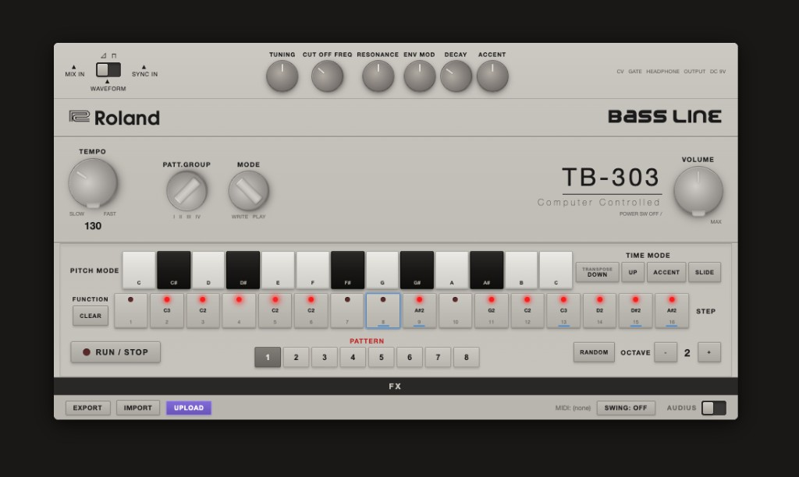

# TB-303 Bass Line



A browser-based TB-303 style bassline synthesizer with a 16-step sequencer. Vanilla HTML/CSS/JavaScript and the Web Audio API.

**Run it:**
```bash
npx serve .
```
Then open http://localhost:3000

## Android app (`android/`)

A standalone, fully offline native Android app (Kotlin, no WebView, no third-party
libraries; only foreground-service and notification permissions) targeting **Android 17 (API 37)**, min Android 8.0 (API 26).

**Sound engine**
- TB-303 voice modelled on Open303's measurements: PolyBLEP saw/square, 44 Hz
  pre-HP, 4-pole diode-ladder model with 150 Hz feedback HP and soft-clipping
  feedback, post 24 Hz HP / 14 Hz all-pass / 7.5 Hz notch, calibrated
  cutoff/env-mod curves, 200 ms accent decay, 60 ms RC slide.
- Accent "sweep" circuit: consecutive accents stack, resonance sets the leak.
- Oscillator and filter run 4× oversampled with a 12th-order anti-aliasing
  decimator (aliasing below −110 dB in tests).
- Sequencer is clocked by the audio sample counter, so timing is sample-accurate.
  Slide uses hardware semantics (slide on a step glides into the next one).
- Overdrive, tempo-synced ping-pong delay, FDN reverb, soft limiter.
- Low-latency float `AudioTrack` at the device's native rate, real-time thread,
  buffer auto-grows on underruns.

**App**
- 16 patterns (2 banks × 8) with per-pattern length, swing, presets, random,
  copy/paste, undo; pattern changes are queued to the end of the loop.
- WAV export (24-bit, 48 kHz) through the system file picker.
- Landscape, full-screen layout with every control on one screen, scaled to
  fit any display. Phones are held in landscape; large screens (where Android
  16+ ignores orientation requests) fall back to a scrolling layout when the
  window is taller than wide.
- Android 17 behaviour: edge-to-edge with inset handling, predictive back,
  resizable windows, audio focus, stops on headphone unplug.
- Background playback: a `mediaPlayback` foreground service with a MediaSession
  keeps the pattern running when you leave the app. Stop it from the
  notification, lock screen, headset/Bluetooth buttons, or by swiping the app
  away. The notification permission is requested once on Android 13+;
  playback works without it.
- TalkBack: knobs are adjustable sliders; every control is labelled.

**Build**
```bash
cd android
./gradlew testDebugUnitTest assembleRelease
# -> app/build/outputs/apk/release/app-release.apk
```
Requires JDK 17+ and the Android SDK with `platforms;android-37.0` and
`build-tools;37.0.0`. Release builds are minified and signed with
`keystore.properties` (`storeFile`, `storePassword`, `keyAlias`, `keyPassword`)
if present, otherwise with the local debug key. CI builds the APK on every push
(see the "Android APK" workflow artifacts).
